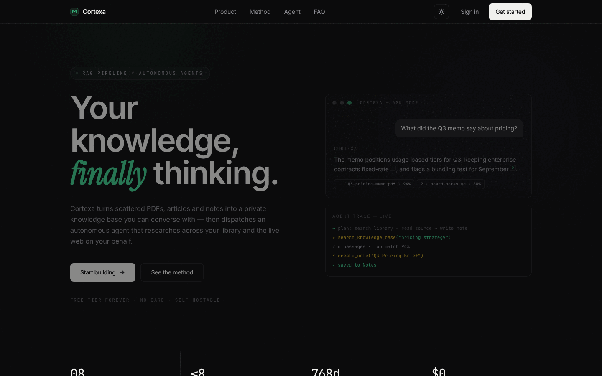
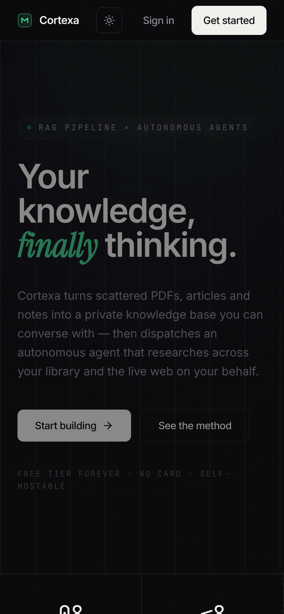
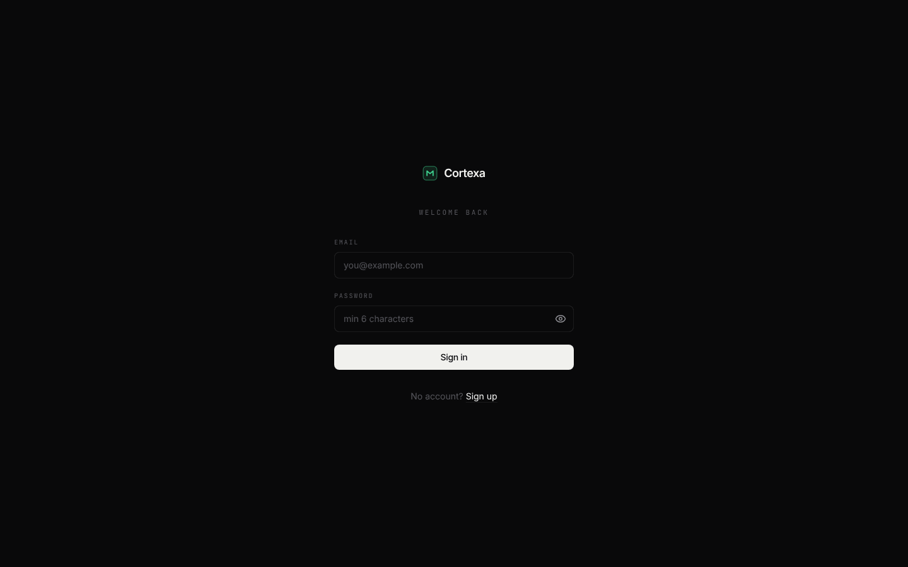
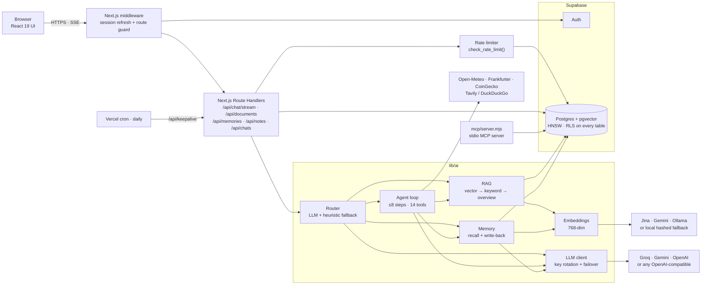
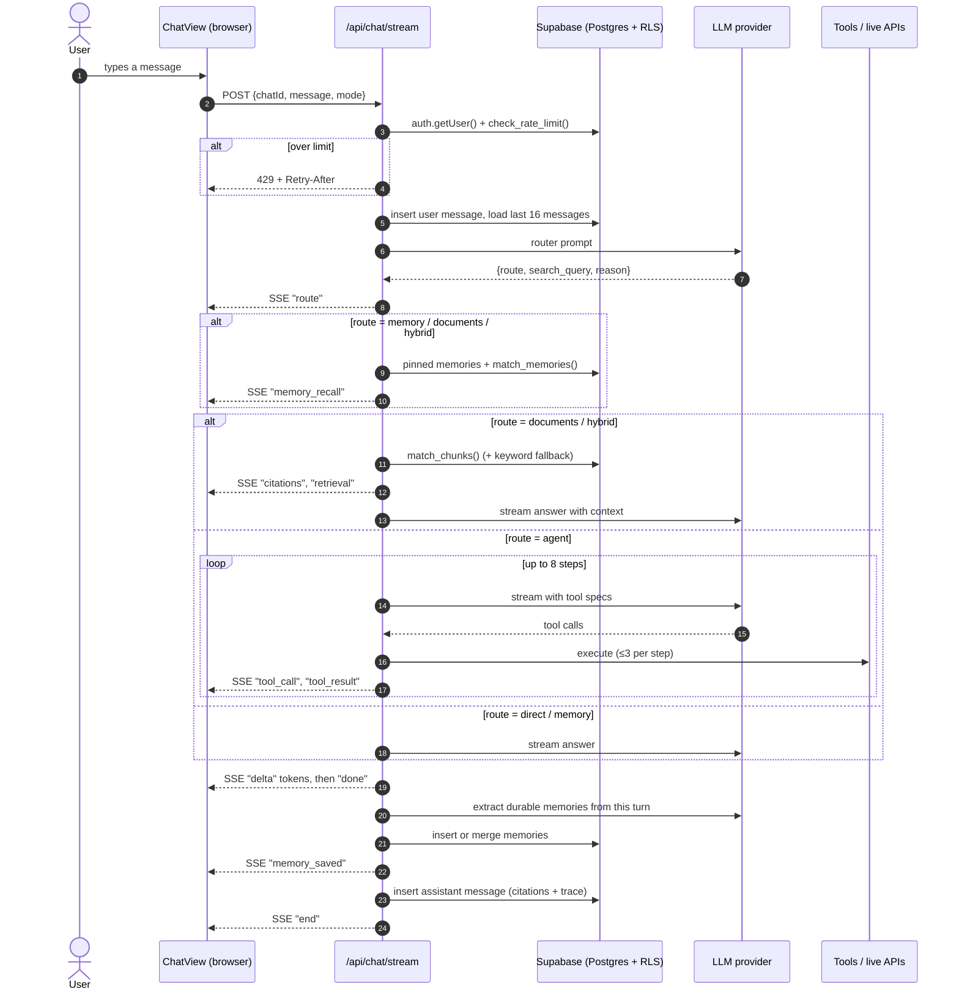
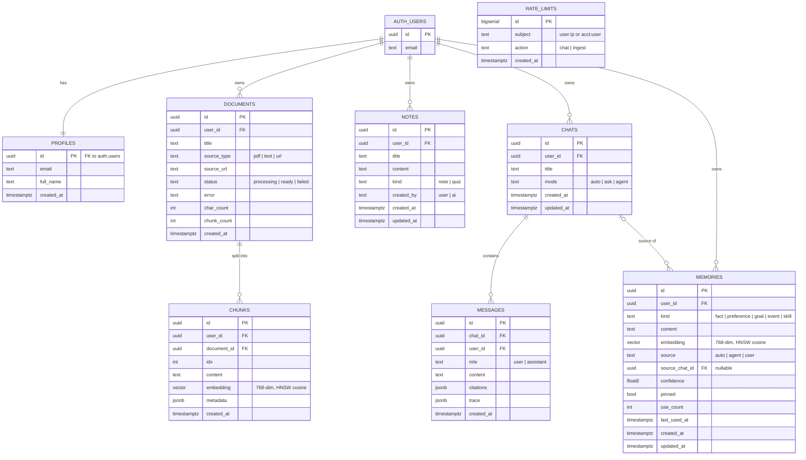

<div align="center">

# Cortexa

**A personal knowledge assistant that decides per question whether to search your documents, recall what it knows about you, call live-data tools, or just answer, and shows you which one it picked.**

[](https://github.com/zakuroooo/cortexa/actions/workflows/ci.yml)


### [▶ Live demo: cortexa-kappa.vercel.app](https://cortexa-kappa.vercel.app)



</div>

---

## Contents

[Problem](#problem) · [Features](#features) · [Screenshots](#screenshots) · [Architecture](#architecture) · [Request flow](#request-flow) · [Data model](#data-model) · [Tech stack](#tech-stack) · [Project structure](#project-structure) · [Getting started](#getting-started) · [Testing](#testing) · [Engineering decisions](#engineering-decisions) · [Limitations & roadmap](#limitations--roadmap)

### Try it without signing up

The live app has a shared demo account, so you don't need to sign up:

| | |
|---|---|
| Email | `demo@gmail.com` |
| Password | `demo@2026` |

> Everyone who uses the demo account sees the same documents and memories, so don't upload anything private.

---

## Problem

Students and anyone who studies or researches a lot end up with their material
spread across PDFs, saved articles and notes. The tools they use to ask
questions about it each have one gap:

- **A general chatbot** doesn't know their documents, doesn't remember them from
  one session to the next, and can't give facts that change daily, like weather
  or exchange rates.
- **A basic RAG app** searches the document store on every message, even "hi".
  It has a single source and no memory of the user.

The result is that people re-explain their context every session, and they can't
tell whether an answer came from their own material, from the model's training
data, or from a live source.

Cortexa adds a **router** in front of retrieval. On each message it picks one of
five paths: no retrieval, documents, memory, both, or a multi-step tool-using
agent. The chosen route appears on the answer, and the app keeps a separate,
editable store of facts about the user that carries across chats.

---

## Features

Each feature below is a user flow, followed by what the code does for it.

**1. Build a library.** Upload a PDF, TXT, MD, CSV or JSON file (up to 10 MB), paste text, or give a URL.
→ The text is extracted (PDFs with `unpdf`), split into 1,200-character chunks
with 180 characters of overlap, embedded as 768-dimension vectors and stored in
Postgres/pgvector. The document's status moves from `processing` to either
`ready` or `failed`, and a failed document shows the reason.

**2. Ask a question in Auto mode.** The answer is labelled with its route:
`direct`, `documents`, `memory`, `hybrid` or `agent`, plus a short reason.
→ An LLM router returns a JSON decision `{route, search_query, reason}`. If the
call fails or the JSON is invalid, a regex heuristic decides instead, so a router
failure never breaks the turn.

**3. Get answers with citations.** Answers that use your documents include numbered `[n]` citations. Each one shows the source title, a snippet and the similarity score.
→ The app runs a vector search over your own chunks (top 6). If fewer than 3 chunks
pass the similarity threshold, it adds keyword (`ILIKE`) matches. If there are
still none, it uses the opening chunks of your 3 most recent documents. If the
library is empty, the answer says so.

**4. Send an agent task.** Ask things like "What's the weather in Kolkata right now?", "Read this URL and save a summary as a note" or "Quiz me on my notes".
→ The agent runs a plan → tool call → observe loop for up to **8 steps**, with
up to **3 tool calls per step**, over **14 tools**:

| Group | Tools |
|---|---|
| Knowledge | `search_knowledge_base` |
| Web | `web_search` (Tavily, DuckDuckGo fallback), `fetch_url` |
| Notes | `list_notes`, `read_note`, `create_note`, `create_quiz` |
| Memory | `recall_memory`, `save_memory` |
| Live data (no API keys) | `get_weather`, `get_current_time` (Open-Meteo), `get_exchange_rate` (Frankfurter), `get_crypto_price` (CoinGecko) |
| Control | `finish` |

Each tool call and its result stream to the chat as a reasoning trace.

**5. It remembers you across chats.** If you say "Remember I'm preparing for exams in December" and later ask "What do you know about me?" in a new chat, it still knows.
→ After each turn, an LLM pulls out durable facts: at most 4 per turn, each
with confidence ≥ 0.5. A new fact that is nearly identical to a stored one is
merged with it instead of added as a duplicate. Before answering, the app loads
pinned memories, then the closest matches, then recent memories to fill any
remaining slots. A "remembered for next time" card shows what was saved.

**6. Manage memory.** The Memory page lists every stored fact. You can add, edit, pin (always included as context) or delete each one.

**7. Notes and quizzes.** Notes you write and notes or quizzes the agent creates go in the same Notes page.

**8. Choose a mode.** Ask mode always uses documents. Agent mode always runs the full tool loop. Settings shows which LLM, embedding provider and web-search backend are active.

**9. Use it from another AI client.** `mcp/server.mjs` makes the knowledge base, memory, notes and live-data tools (8 tools) available over the Model Context Protocol (stdio). Claude Desktop or any other MCP client can then use them.

---

## Screenshots

These were taken with Playwright (headless Chromium) on a local production build
(`next build && next start`) of this commit.

| Landing page: desktop 1440×900 | Landing page: mobile 390 wide |
|---|---|
|  |  |

| Sign in |
|---|
|  |

> The chat card and agent trace on the landing page are part of the page's
> design. They are not output from a real session.
>
> **No screenshots of the signed-in pages (dashboard, chat, documents, memory,
> notes, settings) are available yet.** The environment that produced this
> README couldn't reach the live site or Supabase, and those pages need a live
> database session. Rather than fake them, I left them out. To see them,
> open the [live demo](https://cortexa-kappa.vercel.app) and sign in with the
> demo account.

---

## Architecture



All model calls go through one client in `lib/ai/provider.ts`, which speaks the
OpenAI-compatible API and Gemini's native API. Every API key setting accepts a
comma-separated list. When a key fails with 401/403/408/429 or a 5xx error, it is
put on a 60-second cooldown and the request moves to the next healthy key.

---

## Request flow

This is one chat turn in Auto mode (`app/api/chat/stream/route.ts`):



During long tool calls, the stream sends a heartbeat comment every 15 seconds so
proxies don't drop the connection. The memory write-back step is wrapped in its
own `try/catch`: if it fails, the answer the user already received is unaffected.

---

## Data model

The tables, functions and policies are defined in [`supabase/schema.sql`](supabase/schema.sql).
This one script can be re-run safely and includes a migration block for older
databases.



| Entity | Purpose | Notes |
|---|---|---|
| `profiles` | One row per signed-up user | Created by the `on_auth_user_created` trigger |
| `documents` | One row per upload (PDF, text or URL) | `status` tracks ingestion; deleting a document cascades to its chunks |
| `chunks` | The vector store | `vector(768)` with an HNSW cosine index; searched with `match_chunks()` |
| `notes` | User-written notes and agent-created notes and quizzes | `created_by` separates user notes from AI notes |
| `chats` | Conversations | `mode` saves the chosen Auto, Ask or Agent mode |
| `messages` | Chat history | Assistant rows also save `citations` and the reasoning `trace` as JSONB |
| `memories` | Facts learned about the user | Searched with `match_memories()`; `touch_memories()` updates usage stats |
| `rate_limits` | Sliding-window counters | RLS is on with no policies, so clients can't touch the table directly; only the `SECURITY DEFINER` function `check_rate_limit()` can |

Row Level Security is enabled on all 8 tables. Each user-data table has an
`auth.uid() = user_id` policy, and `profiles` uses `id = auth.uid()`.

---

## Tech stack

| Part | Tool | Why |
|---|---|---|
| Frontend | Next.js 15 (App Router), React 19, Tailwind CSS v4, `lucide-react`, `react-markdown` + `remark-gfm` | Server components for pages that need data, client components for streaming chat. Markdown rendering for answers and notes |
| Backend / API | Next.js Route Handlers (Node runtime), Server-Sent Events | Keeps the app to one repo and one deployment. SSE streams tokens and trace events without needing a WebSocket server |
| AI: LLM | Own client in `lib/ai/provider.ts` for Groq (default `openai/gpt-oss-120b`), Gemini, OpenAI or any OpenAI-compatible endpoint (e.g. Ollama) | Free tiers available, and switching provider needs no code change. Multi-key rotation keeps the app working through rate limits |
| AI: embeddings | Jina `jina-embeddings-v3`, Gemini `gemini-embedding-001`, Ollama `nomic-embed-text`, or a local hashed-vector fallback, all 768-dim | One schema works with every provider. The local fallback means the app runs with no embedding key, at lower quality |
| AI: retrieval & agent | pgvector similarity search, keyword fallback, LLM router, tool-calling loop | Each question only gets the retrieval it needs |
| AI: interop | `@modelcontextprotocol/sdk` | Makes the same knowledge base usable from MCP clients |
| Database | Supabase Postgres + `pgvector` (HNSW) | Relational data, vectors, auth and RLS in one free-tier service, so no separate vector database is needed |
| Auth / security | Supabase Auth (email + password), `@supabase/ssr` cookie sessions, Next.js middleware, RLS, Postgres-backed rate limiting | Data is isolated per user in the database itself, not just in app code. Rate limits hold across serverless instances |
| Testing | ESLint 9, TypeScript strict type-check, Node smoke scripts (`scripts/test-*.mjs`) | See [Testing](#testing). There is no unit-test framework yet |
| CI / deploy | GitHub Actions (lint, type-check, build), Vercel, Vercel cron | Every push is checked. The daily cron keeps the free-tier Supabase project from pausing |

---

## Project structure

```text
app/
  (app)/        signed-in pages: dashboard, chat, documents, memory, notes, settings
  api/          route handlers: chat/stream, documents, memories, notes, chats, status, keepalive
  auth/         Supabase email-confirmation callback
  login/ signup/  auth pages
  page.tsx      public landing page
components/     client UI: ChatView, DocumentsManager, MemoryManager, NotesManager, Sidebar, shared ui
lib/
  ai/           router, agent loop, tools, RAG, memory, embeddings, LLM provider, key rotation, prompts, chunking
  supabase/     browser and server Supabase clients
  ratelimit.ts  per-visitor and per-account rate limiting
mcp/            standalone MCP server (stdio)
scripts/        smoke tests and the Vercel env-sync / deploy script
supabase/       schema.sql: tables, indexes, RLS, triggers, RPC functions
docs/images/    README screenshots
middleware.ts   session refresh and redirects for protected routes
types.ts        shared types
```

---

## Getting started

### Prerequisites

- Node.js 18.18 or newer, which Next.js 15 requires (CI uses Node 22), and npm
- A free [Supabase](https://supabase.com) project
- An LLM API key (a free [Groq](https://console.groq.com/keys) key works). Without one the app starts, but chat returns a configuration error
- Optional: an embedding key such as [Jina](https://jina.ai/embeddings). Without one, the app falls back to local hashed vectors, which match on keywords rather than meaning

### Environment variables

Copy `.env.example` to `.env.local` and fill in the values. These are the names it defines:

| Variable | Needed for |
|---|---|
| `NEXT_PUBLIC_SUPABASE_URL`, `NEXT_PUBLIC_SUPABASE_ANON_KEY` | **Required**: database and auth |
| `LLM_PROVIDER`, `LLM_API_KEY` | Chat (`groq` · `gemini` · `openai` · `custom`). Takes comma-separated keys for failover |
| `GROQ_API_KEY`, `OPENAI_API_KEY`, `GEMINI_API_KEY` | Alternative names for the LLM key; values are merged |
| `LLM_MODEL`, `LLM_BASE_URL` | Optional model override; base URL for `custom` |
| `EMBEDDING_PROVIDER`, `JINA_API_KEY`, `EMBEDDING_MODEL`, `OLLAMA_BASE_URL` | Embeddings (`jina` · `gemini` · `ollama` · `local`) |
| `TAVILY_API_KEY` | Optional web search; DuckDuckGo is used if this isn't set |
| `SUPABASE_SERVICE_ROLE_KEY`, `CORTEXA_USER_ID` | **MCP server only.** Never deploy the service-role key, because it bypasses RLS |

The code also reads two variables that `.env.example` leaves out:
`RATE_LIMIT_DISABLED` and `CRON_SECRET`. The second, if set, protects `/api/keepalive`.

### Run

```bash
npm install
cp .env.example .env.local     # then fill in real values
# Supabase → SQL Editor → paste and run supabase/schema.sql
npm run dev                    # http://localhost:3000
```

### Check and test

```bash
npm run lint          # ESLint
npx tsc --noEmit      # type-check
npm run build         # production build
npm run test:keys     # needs real keys: checks each configured API key
npm run test:backend  # needs real Supabase: auth, tables, RLS
npm run test:agentic  # needs real Supabase + LLM key: schema RPCs, live APIs, router, memory extraction
npm run mcp           # start the MCP server on stdio
```

`npm run deploy:env` syncs `.env.local` to a linked Vercel project and deploys.
It skips the service-role key and the MCP-only variables.

---

## Testing

Here is what was run for this README, with its result:

| Check | Command | Result |
|---|---|---|
| Lint | `npm run lint` | Passes with 0 errors and 0 warnings |
| Type-check | `npx tsc --noEmit` | Passes |
| Production build | `npm run build` (placeholder env from `.env.example`) | Passes; all 20 pages generated |
| CI | `.github/workflows/ci.yml` | Runs all three checks above on every push and PR |

The repo also has **three smoke-test scripts**. They are integration checks
that run against real services, not unit tests:

| Script | What it checks |
|---|---|
| `scripts/test-keys.mjs` | Every configured Groq, Gemini and Tavily key gets a live request, and the result is reported per key |
| `scripts/test-backend.mjs` | Supabase auth works (it signs up and logs in a probe user) and the profile trigger fires; notes INSERT, SELECT, UPDATE and DELETE work for the user's own rows under RLS; a document and a `vector(768)` chunk can be inserted; `match_chunks` returns rows |
| `scripts/test-agentic.mjs` | The `memories` table and the `match_chunks`, `match_memories` and `touch_memories` RPCs exist; Open-Meteo, Frankfurter and CoinGecko respond; the router picks the expected route for 4 sample prompts; memory extraction saves a real fact and ignores small talk |

**These scripts weren't run for this README.** They need real credentials
(`.env.local`), `test-backend` writes a probe user to the database, and the
environment used to write this README couldn't reach Supabase or the external
APIs. So the README gives no pass counts for them.

---

## Engineering decisions

**Retrieval is a routing decision.** A basic RAG pipeline searches the vector
store on every message. Here the router can skip retrieval for small talk, or
pick documents, memory, both, or the agent. That saves calls, and showing the
chosen route makes the system's behaviour visible to the user. The router can't
take a turn down: if it errors or returns invalid JSON, a regex heuristic decides.

**Memory is separate from chat history.** Chat history ends with the chat.
`memories` is its own table with its own embeddings, and it is both read before
answering and written after. Each write runs a similarity check first and merges
near-duplicates (threshold 0.93), so repeating a fact doesn't add another row.
The user can see, edit, pin and delete every stored fact.

**Fail open on extras, fail closed on data.** Memory write-back, memory recall,
usage tracking and the rate limiter all catch their own errors, so none of them
can break an answer. Data isolation works the other way: it is enforced by RLS
in Postgres, so a bug in a route handler still can't read another user's rows.

### Challenges and fixes

| Challenge | Fix |
|---|---|
| **Similarity thresholds don't carry across embedding models.** A dense model and the hashed fallback put unrelated text at very different cosine scores, so one threshold either admits everything or returns nothing. | Each provider gets its own threshold (memory recall 0.65 dense vs 0.08 local; chunks 0.45 vs 0.05). Recall also adds pinned and recent memories, so a weak embedder never silently forgets. |
| **Rate limiting on serverless.** An in-memory counter resets on every cold start and isn't shared between instances. A shared demo login also means per-user limits lock out all visitors at once. | Counters live in Postgres. One `SECURITY DEFINER` function does the check and the record in a single statement, so two concurrent requests can't both slip under the limit. Limits apply per account+IP (chat 30/h, uploads 10/h) and per account (300/h, 60/h). |
| **Free-tier API keys hit 429 errors.** | Every key setting takes a comma-separated list. On a retryable status, the failing key gets a 60-second cooldown and the next healthy key is tried. |
| **Deletes failed without any error.** Under RLS, a `DELETE` that matches no policy removes 0 rows and returns no error, so the UI removed rows that were still in the database. | The UI now shows the server's error instead of removing the row straight away, and policies cover all operations (`for all`). |
| **Switching embedding provider breaks search.** Vectors from different models can't be compared. | A "delete all" endpoint (`DELETE /api/documents`) clears the library for re-upload. All providers output 768 dimensions, so the schema never changes. |
| **The free-tier Supabase project pauses after a week with no activity**, which takes the demo offline. | A daily Vercel cron calls `/api/keepalive`, which runs one tiny query. It can be locked with `CRON_SECRET`. |
| **Agent loops can run on.** | The loop stops after 8 steps and 3 tool calls per step. At the limit, the model is told to write its best answer from what it has gathered. |

---

## Limitations & roadmap

**Current limitations**

- **No unit tests.** Quality checks are lint, type-check, build, and smoke
  scripts that need live credentials. The pure-logic modules (chunking, router
  heuristic, key rotation, JSON parsing) are the obvious first targets.
- **Ingestion happens inside the upload request.** Vercel's Hobby plan caps
  functions at 60 seconds (`maxDuration = 60`), so a very large PDF can time out.
- **Scanned or image-only PDFs** are rejected, because there is no OCR.
- **Retrieval isn't true hybrid ranking.** Keyword search is only a fallback
  when fewer than 3 vector hits come back, not a merged ranking.
- **Changing the embedding provider** means deleting and re-uploading the library.
  There is no in-place re-index.
- **Key health is tracked in memory per serverless instance**, so a cold start
  forgets which keys were cooling down.
- **The demo account is shared** by every visitor.
- **The MCP server only runs locally** over stdio, with a service-role key.
  It isn't part of the deployment.

**Roadmap**

- [ ] Unit tests for `lib/ai` pure functions, plus a small labelled set for router accuracy
- [ ] Background ingestion queue with progress updates
- [ ] Merged ranking of vector and full-text results (e.g. reciprocal rank fusion) instead of a keyword fallback
- [ ] Re-index the library when the embedding provider changes
- [ ] OCR for scanned PDFs
- [ ] Remote (HTTP) transport for the MCP server
